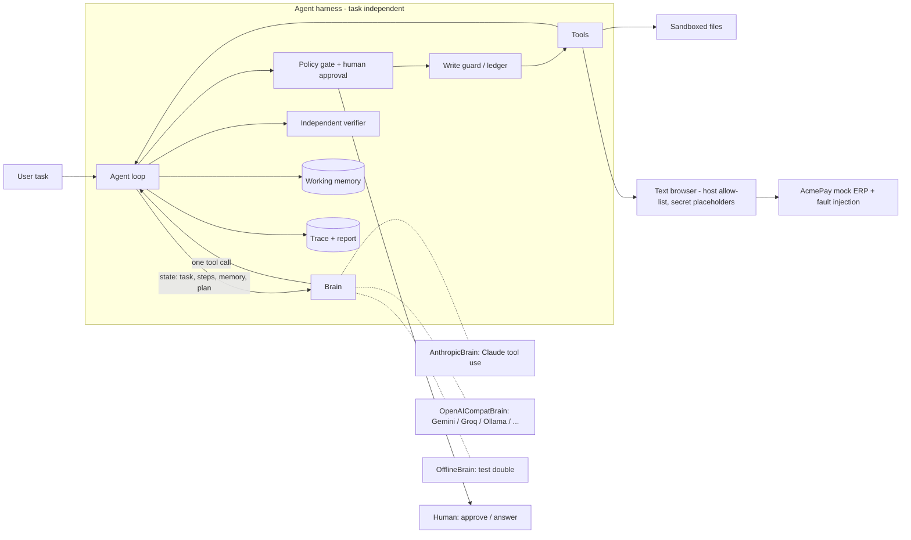

# Demo video
link: https://drive.google.com/file/d/1ecTtrvJQ85-seAImDFwOu7sj_2_e55Hs/view?usp=drive_link

# Autonomous AI Task Worker

An agent that takes a plain-English office task, **does it on a computer** (files + a web app), recovers when things go wrong, **independently verifies** the outcome, and reports with evidence.

> *"Find the latest invoice from Globex, extract the amount and due date, enter it into AcmePay, and tell me once it is done."*

The prototype is deliberately narrow and real: a simulated accounts-payable web app (**AcmePay**) with sessions, CSRF tokens, hidden business rules and injectable faults; a sandboxed inbox of PDF/text invoices with traps; and an agent harness whose safety/reliability logic is **independent of the task and of the model**.

```
python -m worker demo resilient      # watch it survive 503s, an expired session, and a write that commits-then-500s
```

## What's real vs. what's stand-in (read this first)

| Part | Status |
|---|---|
| Agent harness, tools, browser, file sandbox, approval policy, write ledger, retry/reconcile logic, independent verifier, tracing/reporting | **Real**, exercised by 28 tests + 8 end-to-end scenarios |
| Mock ERP (AcmePay) | Simulated company app (as the brief allows). Real HTTP, real forms, real validation |
| **`OpenAICompatBrain`** – LLM tool-use loop over the OpenAI-style API (Gemini, Groq, OpenRouter, Ollama, …) | **Verified live on the happy path with Gemini (free tier):** the model planned, read the inbox, chose the correct invoice (GX-9913, not the file with the newest timestamp), logged in via secret placeholders, entered the bill, and the harness independently verified it (11 steps, `COMPLETED`). Report: `docs/live_gemini_report.md`. **Fault scenarios have not completed live** because the free daily quota ran out; they are verified with the offline brain (below). |
| `AnthropicBrain` – Claude tool-use loop | Implemented; request plumbing unit-tested against a stub and a request reaches the real API (a bad key fails cleanly). **Not yet run end-to-end against the live model** (no paid key). |
| `OfflineBrain` – deterministic, reactive rule policy | A **test double**, not the product. It lets the whole harness run and be regression-tested with no key. It only understands two task shapes (enter-invoice, bills-report). |

The fault, approval and clarification scenarios are therefore proven on the **harness** (with the offline brain), and the **real-model** path is proven on the happy path. I'd rather state that plainly than let a rule-based demo pass as "AI". Because the harness is brain-agnostic, the same ground-truth scenarios can grade any brain (`python -m worker eval --brain <name>`).

## Quick start (setup)

Requires Python 3.10+.

```bash
python -m venv .venv
source .venv/bin/activate            # Windows: .venv\Scripts\activate
pip install -r requirements.txt
```

Run every command below from the repo root. All credentials are fictional sandbox values; no real system is touched, and the browser refuses any host other than the configured sandbox.

## How to test (exact commands)

### A. No API key needed

```bash
python -m pytest -q                         # expect: 28 passed
python -m worker eval --brain offline       # expect: 8 rows PASS, then "ALL PASSED"
```

Narrated demos, one per behaviour (each ends with "ground-truth check passed"):

```bash
python -m worker demo happy --brain offline               # right invoice despite traps; verify by read-back
python -m worker demo resilient --brain offline           # 503s + session expiry + write that commits-then-500s
python -m worker demo clarify --brain offline             # "Northwind" is ambiguous -> asks, then proceeds
python -m worker demo clarify_unanswered --brain offline  # nobody answers -> pauses, writes nothing
python -m worker demo approval_yes --brain offline        # >= 5,000 needs approval; hidden PO rule recovered
python -m worker demo approval_no --brain offline         # human says no -> nothing written
python -m worker demo idempotent --brain offline          # same request twice -> one bill
python -m worker demo generalize_report --brain offline   # different task on the same harness
```

Interactive (you answer the agent's questions in the terminal):

```bash
python -m worker run "Find the latest invoice from Northwind, extract the amount and due date, enter it into AcmePay" --brain offline
#   it asks which Northwind; type 2 (or "Northwind Traders")
python -m worker run "Find the latest invoice from Initech and enter it into AcmePay" --brain offline
#   it asks for approval (18,450 >= 5,000); type yes
```

Non-interactive equivalents: `--answer "Northwind Traders"` and `--yes`.

Hostile environment (flags go on `run`):

```bash
python -m worker run "Find the latest invoice from Globex, extract the amount and due date, enter it into AcmePay" --brain offline --faults flaky_get=2,session_expiry=4,commit_then_500=1
```

Duplicate protection against a persistent app (two terminals):

```bash
# terminal 1
python -m scripts.make_data
python -m mock_erp --port 5055
# terminal 2: run the SAME task twice; the 2nd run reports "already entered"
python -m worker run "Find the latest invoice from Globex and enter it into AcmePay" --brain offline --erp-url http://127.0.0.1:5055
python -m worker run "Find the latest invoice from Globex and enter it into AcmePay" --brain offline --erp-url http://127.0.0.1:5055
# then open http://127.0.0.1:5055 (ap_clerk / sandbox-pass): exactly one bill
```

(`worker run` starts a fresh in-memory app each time unless you pass `--erp-url`, so use `demo idempotent` or the two-terminal flow to test persistence. Reset the inbox any time with `python -m scripts.make_data`.)

Inspect what happened:

```bash
ls runs/                                    # one folder per run
cat runs/<latest>/report.md                 # outcome, verified evidence, side-effect ledger, recovery events
less runs/<latest>/trace.jsonl              # every thought, action, observation (secrets redacted)
```

### B. With a real LLM

Pick one provider. Use `--brain openai` for Gemini/Groq/OpenRouter/Ollama and `--brain anthropic` for Claude. Type keys only into your own terminal.

```bash
# Free: Google AI Studio (key at aistudio.google.com/apikey, no card)
unset ANTHROPIC_API_KEY
export LLM_PROVIDER=gemini
export GEMINI_API_KEY='your-key'
# optional if the default model id is retired/unavailable:  export LLM_MODEL=<model id from AI Studio>

# Free: Groq (key at console.groq.com)
#   export LLM_PROVIDER=groq GROQ_API_KEY='your-key'   (set LLM_MODEL if needed)
# Free and local: Ollama (ollama pull <tool-capable model>)
#   export LLM_PROVIDER=ollama LLM_MODEL=<model you pulled>
# Paid: Claude
#   export ANTHROPIC_API_KEY='your-key'   (optional: WORKER_MODEL=<model id>)
```

Then:

```bash
# 1. the main task, free-form wording (expect: brain=OpenAICompatBrain ... COMPLETED, "verify: PASS")
python -m worker run --brain openai "Find the latest invoice from Globex, extract the amount and due date, and enter it into AcmePay"

# 2. a different phrasing, to show it is not scripted
python -m worker run --brain openai "Get me the newest Initech invoice into AcmePay and tell me when it's done" --yes

# 3. hostile environment with the live model
python -m worker demo resilient --brain openai

# 4. ambiguity and approval with the live model
python -m worker demo clarify --brain openai
python -m worker demo approval_yes --brain openai
python -m worker demo approval_no --brain openai

# 5. the whole suite against the live model (~100 model calls: mind free quotas)
python -m worker eval --brain openai        # or: --brain anthropic
```

Free tiers rate-limit hard. The brain paces its own calls (`LLM_MIN_INTERVAL`, default 7s for Gemini), waits out 429s using the server's suggested delay, and stops with a clear message if the **daily** quota is exhausted (a run may take 2+ minutes; it is not frozen). If the quota is gone, wait for the reset, set a different `LLM_MODEL`, or switch provider.

Save a live run as evidence:

```bash
mkdir -p docs && cp runs/<the-completed-run>/report.md docs/live_gemini_report.md
```

### C. Browse the simulated app yourself

```bash
python -m mock_erp --port 5055                                   # login: ap_clerk / sandbox-pass
python -m mock_erp --port 5055 --faults flaky_get=2,commit_then_500=1,session_expiry=4
```

### Expected outcomes at a glance

| command | expected status | ground truth in the ERP |
|---|---|---|
| `demo happy` / `resilient` | completed | exactly 1 bill: Globex Corporation, GX-9913, 3,120.75, due 2026-11-13 |
| `demo clarify` | completed | 1 bill: Northwind Traders, INV-2077, 4,280.50, due 2026-11-01 |
| `demo clarify_unanswered` | needs_input | 0 bills |
| `demo approval_yes` | completed | 1 bill: Initech LLC, IN-30418, 18,450.00, PO-88123 |
| `demo approval_no` | blocked | 0 bills |
| `demo idempotent` | completed, completed | still exactly 1 bill |
| `demo generalize_report` | completed, completed | `out/bills_report.md` lists GX-9913 |

## Architecture



**Loop:** `observe → decide → gate → act → record → repeat`, ending only when `finish` passes verification.

| Module | Responsibility |
|---|---|
| `worker/agent.py` | The loop. Loop detection, step budget, ledger, finish verification. Knows nothing about invoices. |
| `worker/brains.py` | `AnthropicBrain` and `OpenAICompatBrain`: system prompt + memory/plan injection, rebuild messages every turn, truncate old observations, one tool call per turn; the compat brain also paces requests and handles free-tier rate limits. |
| `worker/builtin_tools.py` | 11 generic tools: `update_plan, remember, ask_user, finish, list/read/search/write_file, web_open, web_click, web_submit_form`. |
| `worker/browser.py` | DOM → numbered links and **typed forms** (fields, select options, hidden CSRF handled automatically). Allow-list, secret substitution, GET retry/backoff, correct POST classification. |
| `worker/policy.py` | When is a write risky enough to need a human? Runs *between* decision and execution, so the model can't skip it. |
| `worker/verify.py` | Executes the claims the agent submits with a fresh read; stores the observed page as evidence. |
| `worker/memory.py` | Plan + facts re-injected every turn (old tool output gets truncated). |
| `mock_erp/app.py` | AcmePay: login/session, CSRF, validation (PO required > 10k, duplicate invoice detection), fault injection. |
| `worker/scenarios.py` | Evals: task + faults + scripted human answers + **assertions against the ERP's actual database**. |

## Key design decisions (and why)

1. **Harness owns trust, the model owns judgment.** The LLM proposes one action at a time; anything that must be reliable (approval, duplicate protection, verification, secret handling, host restrictions) is enforced outside the model. This is what lets a different model, or a different task, drop in unchanged.
2. **Completion is verified, not declared.** `finish(success)` must carry *claims*: a read-only check (web URL or file) plus literal strings that must appear. The harness performs the read itself. A false "done" is rejected (`test_hallucinated_success_is_not_accepted`); after repeated failure the run ends `unverified` and says so. If state was changed and no claims are given, finish is rejected.
3. **Ambiguous writes are not retried blindly.** If a POST dies with a 5xx/timeout it may have been applied (my ERP deliberately commits then 500s). The harness records `ambiguous` in a ledger and **blocks an identical write until a *different* page has been read** (re-opening the same form doesn't count). The agent verifies state, finds the bill, and moves on. Reads, by contrast, are auto-retried with backoff. A POST is classified from *its own* response (post/redirect/get). I originally let `requests` follow the redirect and misread a flaky confirmation page as a failed write — the fault-injection eval caught it (see `WriteAckedError`).
4. **Text browser instead of screenshots.** A DOM-derived snapshot with numbered links and typed forms is deterministic, cheap, testable, and far less brittle than pixel-clicking for a prototype whose goal is reliability. The `Browser` interface could be backed by Playwright for JS-heavy sites.
5. **Secrets as placeholders.** The model writes `{{secret:ERP_PASSWORD}}`; substitution happens at the last moment in the browser; traces redact values (tested).
6. **Human-in-the-loop in two shapes.** `ask_user` for ambiguity (the agent chooses to ask), and policy-triggered approval for risky writes (the harness forces it; the human sees the exact payload; approval is keyed on material fields so a corrected retry isn't re-prompted). Non-interactive runs *pause* as `needs_input` rather than guess.
7. **Memory is explicit.** Old observations are truncated; durable facts go through `remember` and are re-injected each turn, together with the plan and remaining step budget.
8. **Evals check ground truth.** Scenarios assert on the ERP's database (e.g. *exactly one* bill with the right values after commit-then-500), not on the agent's summary, so they grade any brain.

## Scenarios (`python -m worker eval`)

| id | what it proves |
|---|---|
| `happy` | Picks the right invoice despite misleading file timestamps, a newer credit note and 3 layouts/date formats; converts date format; checks duplicates; verifies |
| `resilient` | Flaky GETs (retry), session expiring mid-submit (re-login, fresh CSRF), write that commits then 500s (reconcile, no duplicate) |
| `clarify` / `clarify_unanswered` | "Northwind" matches two vendors → asks; with no answer it pauses and writes nothing |
| `approval_yes` / `approval_no` | ≥ 5,000 needs approval; ERP's hidden "PO required > 10k" rule is discovered from the validation error and fixed; a "no" writes nothing |
| `idempotent` | Same request twice → one bill |
| `generalize_report` | A different task (report to a file) on the same harness |

## Assumptions
- A single human operator is reachable via terminal, or answers are pre-supplied.
- Invoices are digital-text PDFs/txt (no OCR). Vendor names in documents resemble ERP vendor names.
- "Latest" means latest *invoice date written in the document*.
- Approval threshold (5,000) and the allowed host come from `Config`, i.e. from the environment rather than code.
- The sandbox ERP is the only system of record; credentials are fictional.

## Known limitations
- **Live-model coverage is partial:** the happy path is verified live (Gemini, free tier); the fault/approval/clarification scenarios are verified with the offline brain, and the live runs were cut short by free-tier daily quota. `AnthropicBrain` is untested live. Expect prompt tuning when the full suite is graded with a live model.
- Observed live-model weakness: Gemini went straight to the form without first checking whether the bill already existed. The harness still protects against duplicates (app-side duplicate check, write ledger, finish-time verification), but a stronger prompt/plan step would avoid the wasted attempt.
- Free-tier models are rate-limited, so live runs are slow (the happy path took ~2 minutes) and quota can run out mid-run; the run then ends cleanly as `failed` with the reason.
- Text browser: no JavaScript execution, file uploads, or CAPTCHAs; only form-based apps.
- The "applied" judgment for a write is HTTP-based (2xx/3xx); an app that returns 200 with an error banner relies on the verifier as the backstop.
- Verification checks literal strings on a page; it can't judge semantic correctness (e.g. that the amount was *extracted* correctly from the source). A second-reader check against the source document is a natural extension.
- PDF text extraction only; no OCR for scans. No parallel tool use, one agent, no long-term cross-run memory.
- Token/cost budgeting is a step budget only.
- Retries are per call; there is no run-level "resume after crash" (the JSONL trace has what's needed).

## What I'd build next
1. Run the full eval suite against a live model with higher quota, tune prompts (e.g. an explicit duplicate-check step), and add a small matrix of *novel* tasks (e.g. "mark the 3 oldest bills as paid", "reconcile this CSV with AcmePay").
2. Playwright-backed `Browser` with the same snapshot interface, plus screenshot fallback for canvas-heavy UIs.
3. Source cross-check verifier: re-extract the invoice values with a second pass and compare to what's in the system of record.
4. Resumable runs (replay the trace), per-tool idempotency keys, and a proper approval UI (Slack/web) instead of the terminal.
5. OCR for scanned invoices; email/IMAP and API tools next to files and browser.
6. Cost/latency budgets, parallel read-only tool calls, and a learned "skills" cache for repeated workflows.

## Models, APIs, and components
- **LLMs (pluggable, one at a time):**
  - Google Gemini via its OpenAI-compatible endpoint (free tier), through `OpenAICompatBrain`. This is what the verified live run used.
  - Also supported by the same brain: Groq, OpenRouter, a local Ollama model, or any OpenAI-compatible URL (`LLM_PROVIDER` / `LLM_BASE_URL` / `LLM_MODEL`).
  - Anthropic Claude via the official `anthropic` SDK with tool use (`WORKER_MODEL`, default `claude-sonnet-5-5`) through `AnthropicBrain`.
  - Nothing outside `brains.py` calls a model.
- **Libraries:** Flask/Werkzeug (mock ERP), requests + BeautifulSoup4 (browser, and HTTP to OpenAI-style APIs), pypdf (PDF text), ReportLab (generate synthetic invoices), pytest. The `anthropic` package is only needed for `AnthropicBrain`.
- **Built with AI assistance** (Claude) for scaffolding; the design, the fault-injection experiments, and the bug in decision 3 are documented above so I can explain, debug, or modify any part.

## Repo layout
```
worker/        agent harness, brains, tools, browser, policy, verifier, scenarios, CLI
mock_erp/      AcmePay sandbox app (+ fault injection)
scripts/       synthetic invoice generator (PDF/txt, with traps)
tests/         harness guarantees (adversarial brains), brain plumbing, e2e scenarios
docs/          demo script, sample run output, sample report, live Gemini report (add yours)
```